# Ideomancer's Machine Mod

A Minecraft Forge 1.20.1 mod about moving blocks and flying machines: Oddstone and sympathetic movement, Odd Slime,
the Repulser and Attractor, Oddstone portals, Hollowstone, the Machine Base and all its machines, Frames and Framed
Blocks, the Redstone Rod and the Drill.

It is the Oddstone-and-machines part of [Ideomod](https://github.com/Socratique/Ideomod-Public), as a mod of its
own (mod id `machinemod`). Ideomod's Furnace Array and Judgement effect are not in it. The two can be installed
together: see [Living alongside Ideomod](#living-alongside-ideomod).

The intro and disclaimers below are the Ideomancer's, written for Ideomod.

> *"This is an incomplete prototype for my vision of a vanilla++ style overhaul of Minecraft. The full vision is roughly outlined, as recorded by Claude, in the [design document](https://github.com/Socratique/Ideomod-Public/blob/main/docs/dev/IDEOMOD_DESIGN.md).*
>
> *What exists so far mainly centres on Oddstone and on expansions to sticky blocks, flying machines, and moving blocks and contraptions in general."*
>
> — The Ideomancer

### Disclaimers

- The implementation and development of this mod was almost entirely handled and written by Claude, directed by me.
- Almost all textures were made by me, influenced by some vanilla textures. The Oddstone, Cobbled Oddstone, Oddstone Bricks and Odd Slime textures, and the Odd Slime model, were commissioned from Lorenzo N. ([napino](https://linktr.ee/napino)), via Fiverr. The Drill textures were made by Claude, as was the animated Oddstone portal texture; the Repulser and Attractor were moved onto the Oddstone texture by Claude, keeping my original designs.
- This Repo was put together by Claude. The intro and Disclaimers were written by me.

## Status and download

**Work in progress.** Things will change, and some parts are rough (see [Known rough edges](#known-rough-edges)).
There is no release yet: one will be on this repository's Releases page and on CurseForge. Until then, build it
yourself ([Building and running](#building-and-running)) and put the jar in the `mods` folder of a Minecraft 1.20.1
Forge install. It is needed on both the client and the server.

| | |
|---|---|
| Minecraft | 1.20.1 |
| Loader | Forge 47.x (built against 47.4.10) |
| Mod version | 0.1.0 |
| Java | 17 |

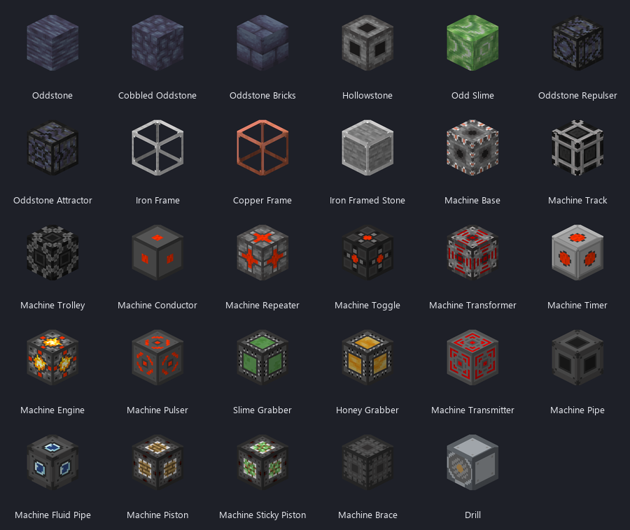

In game, everything is in the **Machine Mod** creative tab. A second tab, **Framed Blocks**, lists every framed block.

*The animations in this README are illustrations drawn from the mod's own textures, not screen captures (see [About the pictures](#about-the-pictures)).*

## Contents

- [Status and download](#status-and-download)
- [Oddstone](#oddstone)
- [Odd Slime](#odd-slime)
- [Oddstone Repulser and Attractor](#oddstone-repulser-and-attractor)
- [Oddstone Portals](#oddstone-portals)
- [Hollowstone](#hollowstone)
- [The Machine Family](#the-machine-family)
- [Frames and Framed Blocks](#frames-and-framed-blocks)
- [Smaller things](#smaller-things)
- [What changes about vanilla pistons](#what-changes-about-vanilla-pistons)
- [World generation](#world-generation)
- [Recipes](#recipes)
- [Configuration and commands](#configuration-and-commands)
- [Living alongside Ideomod](#living-alongside-ideomod)
- [Known rough edges](#known-rough-edges)
- [For developers](#for-developers)
- [License](#license)

## Oddstone

Oddstone is a dark stone found underground. It is the centre of the mod: most of the other blocks either are made from it or react to it.

It comes in three full blocks (Oddstone, Cobbled Oddstone, Oddstone Bricks), each with a wall, stairs and slab. They do not all share the same properties:

| | Oddstone | Cobbled / Bricks | Walls, stairs, slabs |
|---|:---:|:---:|:---:|
| Sympathetic movement | yes | yes | yes |
| Grabs slime, honey and Odd Slime | yes | yes | no |
| Land mobs avoid it | yes | yes | no |
| Blocks redstone like glass does | yes | yes | no |
| Forms portal frames | no | Cobbled only | no |
| Cools lava into Hollowstone | yes | no | no |

### Sympathetic movement

When a piston moves an Oddstone block, other Oddstone blocks of the same kind move with it, without touching it.

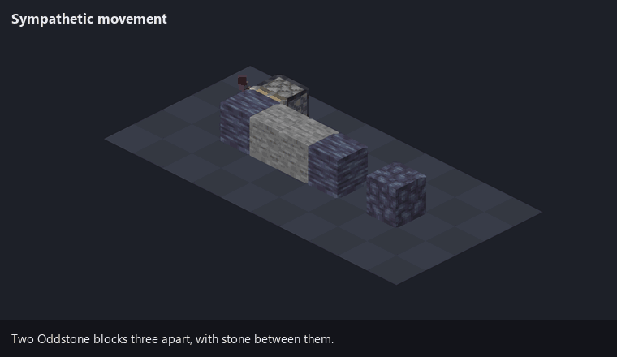

The rule:

- From the moved block, the mod looks along the six axis lines (not diagonals), up to 12 blocks each way (set in the config).
- The first block of the **same channel** found in each direction is linked and moves too. Whatever sits in between, solid or not, is ignored.
- Links chain: each linked block looks along its own six lines.
- Every block type is its own channel, so there are twelve: Oddstone, Cobbled Oddstone, Oddstone Bricks, and the wall, stairs and slab of each. Oddstone never links with Cobbled Oddstone.
- A linked block moves the way any pushed block does. It pushes what is in front of it and brings along anything stuck to it.
- Everything counts toward the one piston push limit (12, or more with [Machine Braces](#brace)).
  A linked block that would itself go over the limit is left behind and the rest of the move goes ahead;
  but if a linked block would push or pull other blocks over the limit (or into something immovable),
  the whole move fails, as a vanilla piston refuses.

A sticky piston cannot pull a sympathetic block directly. It retracts and leaves the block where it is.

### One-way stickiness

Oddstone, Cobbled Oddstone and Oddstone Bricks grab slime blocks, honey blocks and Odd Slime. Nothing can grab them back.

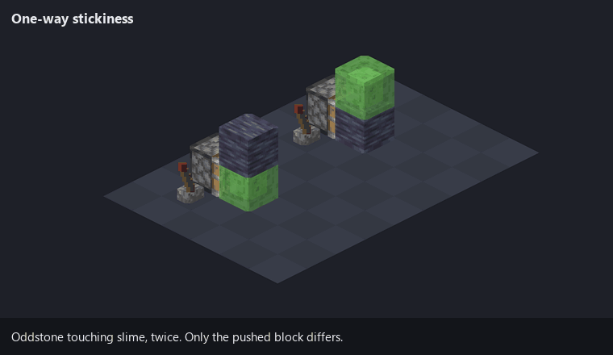

They only grab those sticky blocks. They do not grab ordinary blocks, and they do not grab each other by contact, because Oddstone-to-Oddstone connections go through sympathetic movement instead.

### Mob avoidance

Land mobs path around Oddstone, Cobbled Oddstone and Oddstone Bricks, and treat the blocks next to them as dangerous. By default that is every vanilla mob that walks; flying and swimming mobs never path over blocks, so they are not listed.

#### Mobs from other mods

Mobs added by other mods are not on the default list, so they walk over Oddstone as normal. To make one avoid it, add its id to `affected_mobs` in `config/machinemod/machinemod.json` and run `/machinemod reload` (or restart):

```json
"oddstone": {
  "affected_mobs": [
    "minecraft:zombie",
    "alexsmobs:grizzly_bear"
  ]
}
```

The file is created on first launch with every vanilla land mob already listed; add the new ids to that list (the id is the one `/summon` uses). Removing an entry stops that mob avoiding Oddstone.

### Redstone insulation

The three full blocks do not conduct redstone. A powered Oddstone block does not power what is behind it, the same as glass.

## Odd Slime

A slime block with a direction. It is sticky on all six sides, but only when it is pushed the way it faces. Pushed any other way it behaves like an ordinary block and takes nothing with it.

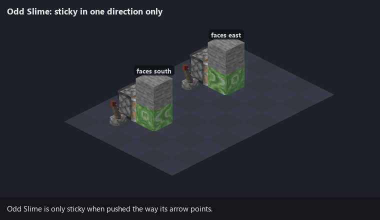

It is placed like a piston, facing you. It never sticks to slime or honey blocks, and it cannot grab Oddstone.

Like a vanilla slime block it has a smaller block inside it; Odd Slime's is Oddstone, seen through the slime.

## Oddstone Repulser and Attractor

Two blocks that move Oddstone at a distance. Each acts along the line it faces, up to 12 blocks, and ignores whatever is in between.

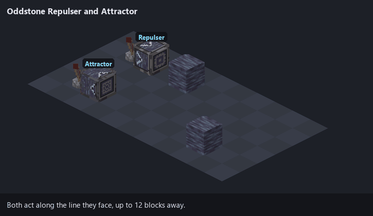

- **Repulser:** on each redstone pulse, pushes the *nearest* Oddstone on its line one block away.
- **Attractor:** on each redstone pulse, pulls the *farthest* Oddstone on its line one block closer.

They act on a rising edge, so one pulse is one block. The target is any Oddstone block: Oddstone, Cobbled Oddstone or Oddstone Bricks, their walls, stairs and slabs, or any of them framed. The move is a normal piston move starting at the target, so stickiness, sympathetic links and the push limit all apply. Nothing happens if the move is blocked or would push a block into the device.

## Oddstone Portals

A portal frame is an upright rectangle of Cobbled Oddstone with a mineral block at each of the four corners.

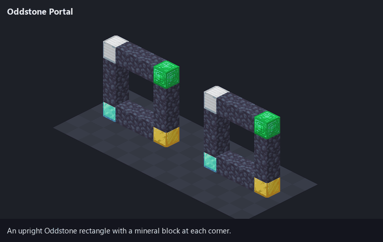

- **Shape:** vertical only. The opening is 3 to 19 blocks wide and 3 to 19 tall, and must be empty.
- **Corner blocks:** blocks of coal, iron, copper, gold, redstone, lapis, diamond, emerald, netherite, quartz or amethyst, or raw iron, raw copper or raw gold blocks.
- **Lighting it:** throw an ender pearl at the frame. The pearl is used up and you are not teleported by it.
- **Address:** the four corner blocks are the portal's address. It reads the same from both sides.
- **Linking:** the first portal with a given address is unlinked. A second portal with the same address, in the same dimension, links to it. A third will not light.
- **Linked portals:** walking in puts you at the matching spot in the other portal, facing out of it. This works between portals of different sizes.
- **Unlinked portals:** walking in throws you 200 to 1000 blocks in a random direction, onto the surface, and costs 5 hearts.
- **Limits:** players only, with a 4 second cooldown.
- **Closing:** break or move any frame block or corner block. The partner becomes unlinked.
- **Look:** a lit portal is a slow light-blue swirl with white sparks. Like a nether portal it gives off (light-blue) particles and hums now and then.

## Hollowstone

Hollowstone forms where Oddstone meets lava. Any lava *source* block touching Oddstone turns into Hollowstone. Flowing lava does not, and the Oddstone is not used up.

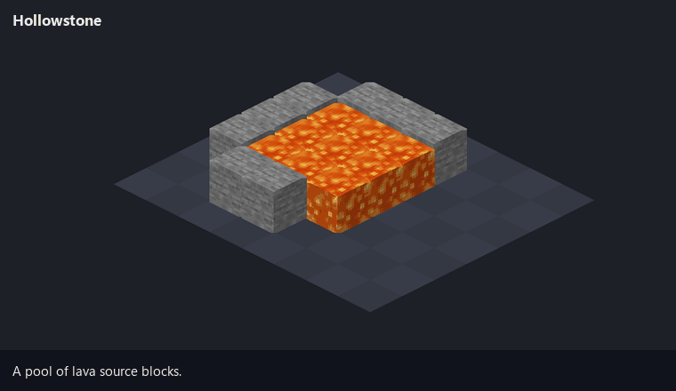

- Right-click an empty Hollowstone with a full block to put that block inside it. This is for looks only. Blocks with inventories or other stored data cannot go in.
- Mined normally it drops 5 to 7 Hollowstone Shards (Fortune applies). Nine shards craft back into one Hollowstone. Silk Touch drops the block itself, keeping whatever is inside it, as framed blocks do: the item is named after it ("Hollowstone with Glass") and places back filled.
- When a filled Hollowstone is mined without Silk Touch, the block inside is left standing in its place.

## The Machine Family

The Machine Base is one block that becomes many. Right-click it to open a one-slot GUI. The item you put in the slot decides what the block is. Take the item out and it is a Machine Base again.

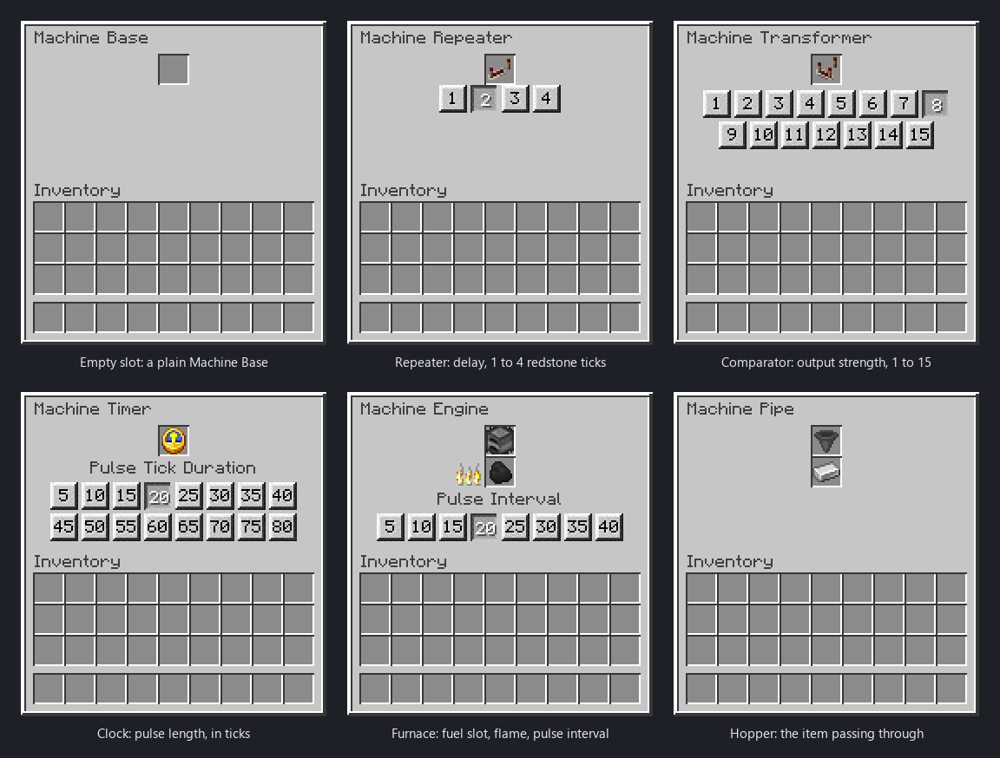

The GUI changes with the item in the slot. Most machine blocks show only the slot; the six above are the ones with more to them.

| Put this in the slot | It becomes |
|---|---|
| *(nothing)* | [Machine Base](#machine-base) |
| Redstone Dust | [Machine Conductor](#conductor) |
| Repeater | [Machine Repeater](#repeater) |
| Lever | [Machine Toggle](#toggle) |
| Comparator | [Machine Transformer](#transformer) |
| Clock | [Machine Timer](#timer) |
| Any button | [Machine Pulser](#pulser) |
| Furnace | [Machine Engine](#engine) |
| Any Oddstone-family block | [Machine Transmitter](#transmitter) |
| Piston | [Machine Piston](#machine-piston-and-sticky-piston) |
| Sticky Piston | [Machine Sticky Piston](#machine-piston-and-sticky-piston) |
| Machine Base | [Machine Brace](#brace) |
| Powered Rail | [Machine Track](#track-and-trolley) |
| Minecart | [Machine Trolley](#track-and-trolley) |
| Slime Block | [Machine Slime Grabber](#grabbers) |
| Honey Block | [Machine Honey Grabber](#grabbers) |
| Hopper | [Machine Pipe](#item-pipe) |
| Bucket (empty) | [Machine Fluid Pipe](#fluid-pipe) |

Things all machine blocks share:

- **They stick together.** A Machine Base sticks to every machine block. A specialised block sticks only to its own kind and to Machine Bases. So a Track does not stick to a Trolley, and a Piston does not stick to a Sticky Piston.
- **They keep their contents when moved.** Pistons can push them, and the slot item, settings, timers, fuel and held items all survive the move.
- **Slime can grab them, they cannot grab slime.** The exception is a switched-on [Grabber](#grabbers).
- **They drop as what they are.** A broken Machine Timer drops a Machine Timer with its clock inside. The creative tab has every kind ready-made.
- **Settings reset on a swap.** Changing the slot item makes a new block, so a new Repeater starts at delay 1.

### The redstone blocks

Repeater, Toggle, Transformer, Timer, Pulser and Engine share one model. The face receiving the strongest signal is the **input**. The block outputs on the **other five faces**, and it powers through solid blocks as a vanilla repeater does. Each has a coloured indicator that is dark when off and red when on.

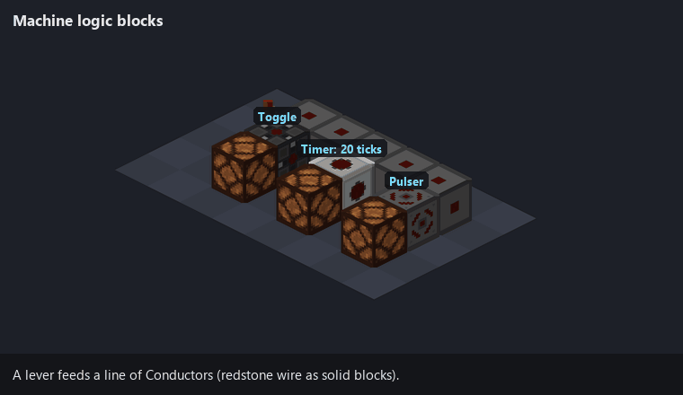

#### Conductor

Redstone wire as a solid block. Signal strength drops by 1 per Conductor, as with dust. It takes input on one face and outputs on the other five. The indicator gets brighter with signal strength.

#### Repeater

Outputs full strength (15) while its input is on. The GUI has four buttons for the delay: 1 to 4 redstone ticks. It cannot be locked.

#### Toggle

A flip-flop. Each time the input goes from off to on, the output flips. The input has to go off and come back on before it flips again. A signal that is already on when you place the Toggle is ignored until it drops.

#### Transformer

Outputs a strength you choose, from 1 to 15, whenever its input is on at any strength. The GUI has fifteen buttons.

#### Timer

When the input turns on, outputs full strength for a set time, then stops. The time always runs to the end, whatever the input does. It fires again only after the input has gone off and come back. The GUI offers sixteen durations, 5 to 80 ticks by default (20 ticks = 1 second).

#### Pulser

A Timer with a fixed, very short output: one redstone tick (2 game ticks). It turns any signal into a single short pulse.

#### Engine

A clock that runs on fuel. While it has a redstone signal and fuel, it gives a short full-strength pulse at a regular interval.

- Fuel is anything a furnace burns, for as long as a furnace would burn it. Fuel is only used while the Engine has a signal.
- The GUI has a fuel slot, a flame gauge and eight interval buttons: 5 to 40 ticks by default.
- Hoppers and Machine Pipes can feed the fuel slot.
- A comparator reads how full the fuel slot is.

#### Transmitter

Wireless redstone. The Oddstone-family block in the slot is the **channel**. Twelve blocks, twelve channels.

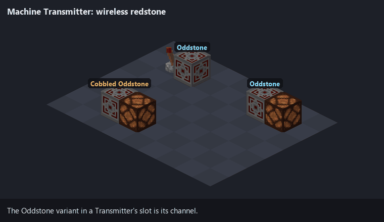

- A Transmitter that receives redstone becomes a **source**. It outputs nothing itself.
- Every other Transmitter on the same channel within 12 blocks in each direction becomes a **receiver**, and outputs the source's strength minus 1 on all six faces.
- Receivers do not relay to further receivers.
- If several sources are in range, the strongest wins.
- The range is the same config value as the sympathetic movement range.

### Movement blocks

#### Machine Piston and Sticky Piston

A piston with no front. A signal on one face extends an arm from the opposite face. Signals on several faces extend several arms at once.

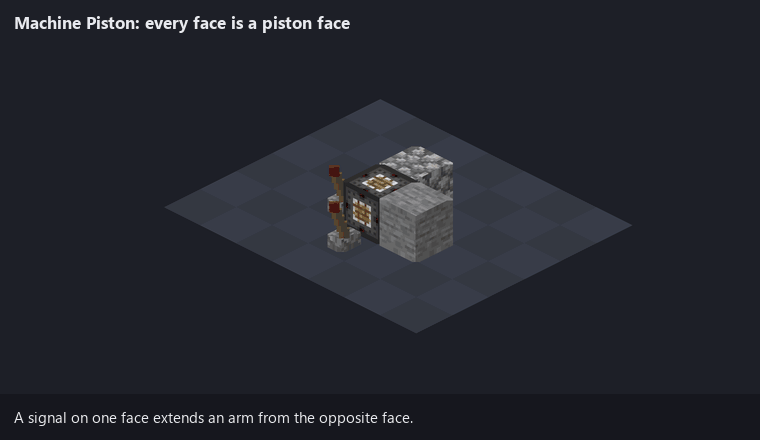

- Each arm stays out while its signal lasts, and retracts when it goes.
- It pushes as a vanilla piston does, with the same push limit.
- The sticky version pulls the block in front of the arm back when it retracts.
- It cannot be moved by another piston while an arm is out.

#### Brace

Raises the piston push limit. Each Brace in the group being moved adds 6 to the limit of 12, up to eight Braces and a limit of 60.

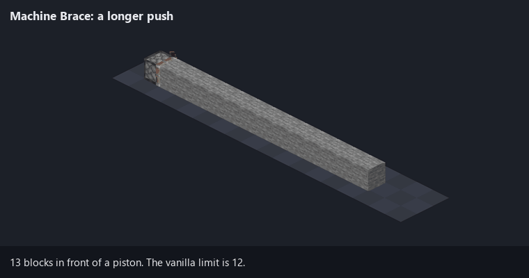

This applies to vanilla pistons, Machine Pistons, Tracks, Repulsers and Attractors. A Brace has to be within reach at the current limit to count, so put the first one near the piston.

#### Track and Trolley

A Track pushes Trolleys. When a Track's signal turns on, every Trolley touching it moves one block, away from the side the signal came from. Lay Tracks in a line, set a Trolley on top, and power the line from one end: each pulse moves the Trolley one block along it.

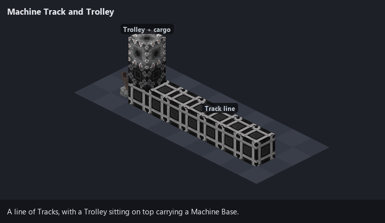

- One pulse moves a Trolley one block.
- The Trolley moves as a pushed group, so it carries what is stuck to it: other Trolleys, Machine Bases, and anything those hold.
- Tracks pass their signal along to neighbouring Tracks, losing 1 strength per Track. They do not power anything else. A grey indicator in each Track shows its signal, so a pulse can be seen fading along the line.
- The Trolley itself does nothing. It is the thing that gets moved.

#### Grabbers

A slime block or honey block with a switch. Each redstone pulse flips it on or off.

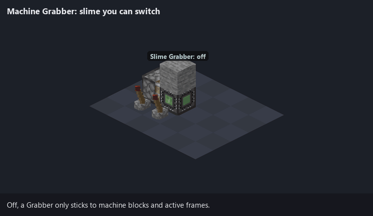

- **Off:** it sticks only to machine blocks and active frames.
- **On:** it also grabs as a slime block (Slime Grabber) or honey block (Honey Grabber) does. Like slime, it grabs only when it is the one moving: a machine block pushed past or under it does not drag it along (unless that block sticks to Grabbers anyway, as a Machine Base does).

For one tick after being moved by a piston, Grabbers and Toggles ignore redstone changes, so a contraption does not flip its own switches while its parts land.

### Transport blocks

#### Item Pipe

Passes items along, one at a time, at hopper speed.

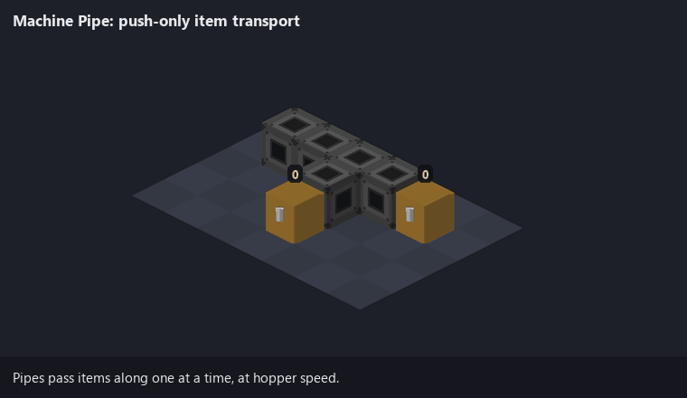

- **Push only.** A pipe never pulls from a container and never drops items on the ground.
- It pushes into anything that accepts items from that side: chests, hoppers, other pipes, an Engine's fuel slot.
- It prefers to send items straight on from the face they came in. With more than one valid output it takes turns between them. It never sends an item back the way it came.
- A redstone signal stops it, as with a hopper.
- Items get in through the GUI, from a hopper, or from another pipe.
- A comparator reads how full it is.

#### Fluid Pipe

Holds one bucket of water or lava.

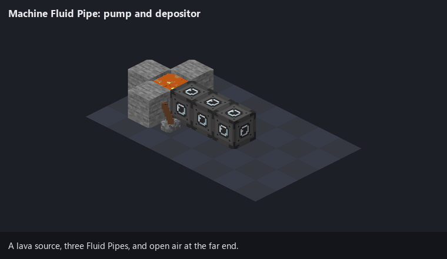

- **Powered and empty,** it takes an adjacent water or lava source block, or empties a full cauldron. Flowing fluid is ignored.
- **Holding fluid,** powered or not, it passes it to the next empty Fluid Pipe. If there is none, it places the fluid in the world: a source block into air, or into a cauldron.
- The redstone logic is the reverse of the Item Pipe: here a signal means "pump".
- Water meeting lava inside a pipe uses up both and leaves obsidian in the slot, which turns that pipe back into a Machine Base.
- A pipe holding lava gives off light. A comparator reads empty or full.
- Broken while full, it keeps its fluid: placed again it is still full. A Machine Base given a water or lava
  bucket becomes a full Fluid Pipe; taking the bucket out turns it back into a Machine Base.

### Machine Base

With an empty slot, the Machine Base is the connector. It sticks to every machine block, which makes it the glue of a contraption. It is also what switches [frames](#frames-and-framed-blocks) off.

Its look shows which it is doing: unpowered (switching frames on) it shows a filled centre; powered by redstone (switching them off) the centre opens and the red machine indicator shows through.

## Frames and Framed Blocks

Iron Frames and Copper Frames are see-through blocks that are only sticky while they are **active**.

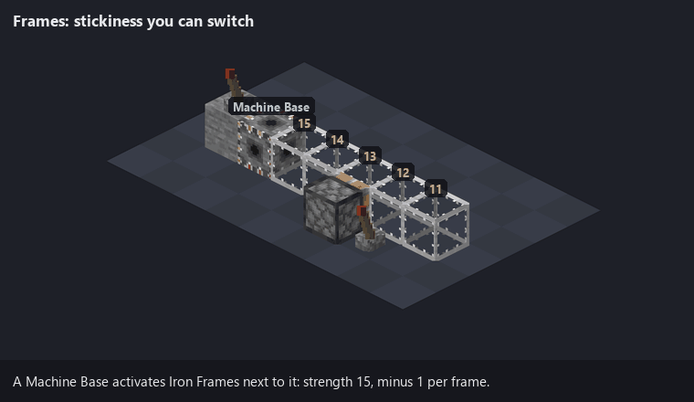

How activation works:

- Any machine block touching a frame activates it at strength 15. Each further frame in the chain gets 1 less. A frame with strength above 0 is active, so a chain reaches 15 frames from its source.
- Activation only travels through frames of one metal. Iron passes it to iron, copper to copper.
- An active frame sticks to other active frames of the same metal and to machine blocks. It does not grab ordinary blocks.
- **A Machine Base that is powered by redstone does the opposite.** It stops activating and sends an "off" signal of the strength it receives, which also drops by 1 per frame. Any frame that signal reaches is inactive, whatever else is activating it. Only the plain Machine Base does this. Specialised machine blocks always activate.

So a row of frames is a rigid beam when active, and a row of loose blocks when not, and a lever decides which.

Frames can be waterlogged. Like glass, they do not carry redstone.

### Framed Blocks

Craft a frame with a block and you get that block inside a frame: Iron Framed Stone, Copper Framed Glass, and so on. About 340 blocks can be framed (the `machinemod:frameable_blocks` tag, which datapacks can extend).

A framed block:

- behaves as a frame for stickiness, and activates the same way;
- keeps most of what the inner block does: hardness and tool, sounds, light, redstone output, slipperiness, and walking effects such as soul sand's slowness or honey's low jump;
- takes a little longer to mine than the inner block, always needs a pickaxe, and drops as the framed block;
- moves with pistons and keeps its inner block.

Some inner blocks add behaviour:

- **Framed slime, honey or Odd Slime** is sticky in the inner block's own way even when the frame is inactive.
- **Framed Oddstone** grabs slime-type blocks, moves sympathetically on the Oddstone channel, and counts as Oddstone for the Repulser and Attractor.
- **Framed obsidian, crying obsidian or reinforced deepslate** cannot be moved at all. Stuck into a contraption, it anchors the whole thing.

Looking at a framed block with F3 open shows the inner block on the right-hand side.

## Smaller things

**Redstone Rod.** A hand tool. Right-click a block face to give that block a full-strength redstone pulse from that side, one redstone tick long. It fires before the block's own right-click, so it does not open GUIs. Good for testing a contraption by hand.

**Drill.** On a redstone pulse, breaks the 3×3 area of blocks directly in front of it, one block deep, and drops the items at the drill.

**Structure Debug Stick.** A creative-only tool. While you hold it, chat reports what portals are doing.

## What changes about vanilla pistons

The mod alters how the piston works out what to move. In play that means:

- Blocks can be sticky in one direction only, or only towards certain blocks (Oddstone, Odd Slime, machine blocks, frames).
- Sympathetic blocks join a move from a distance.
- Machine Braces raise the push limit.
- Machine blocks and framed blocks can be pushed and keep their stored data. Vanilla chests, furnaces and the like are still immovable.
- A sticky piston will not pull a sympathetic block directly.

Slime and honey blocks behave as in vanilla, except that they cannot grab Oddstone or Odd Slime.

## World generation

- **Oddstone** generates as an ore in every overworld biome: veins of up to 7, replacing stone and deepslate, five tries per chunk below Y 0 and three between Y 0 and 63.
- **Hollowstone formations** generate at underground lava: a few Oddstone blocks on the shore of a lava pool, with the lava next to them turned to Hollowstone.
- **Ore Only (Debug)** is an extra world type. It generates the overworld and then removes everything that is not an ore, Oddstone or Hollowstone. It is for checking ore distribution.

## Recipes

Recipes appear in the recipe book as you pick up what they need: Oddstone unlocks the Oddstone blocks, Odd Slime, the Repulser and Attractor; Hollowstone unlocks the Machine Base; a Hollowstone Shard unlocks Hollowstone; iron and copper unlock their frames. Framed blocks (any frame plus a block) are not listed in the book.

Pictures drawn in the 1.20.1 crafting windows by `tools/renders/recipes.py`, straight from the recipe files.

### Machines, frames and tools

<table>
<tr><td align="center">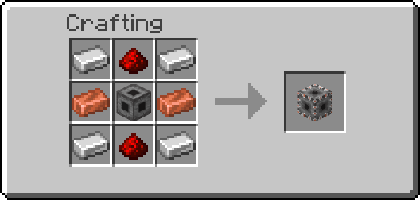<br>Machine Base</td><td align="center">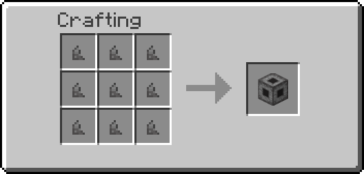<br>Hollowstone, from shards</td></tr>
<tr><td align="center">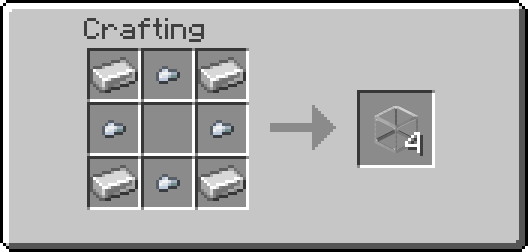<br>Iron Frame ×4</td><td align="center">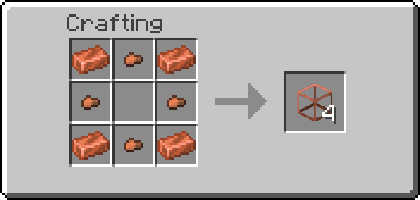<br>Copper Frame ×4</td></tr>
<tr><td align="center">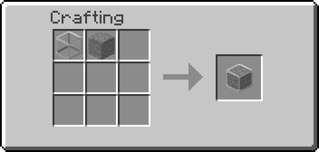<br>Framed block: any frame + any frameable block</td><td align="center">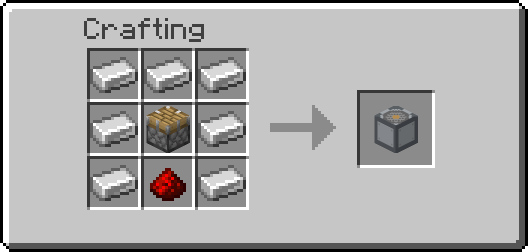<br>Drill</td></tr>
<tr><td align="center">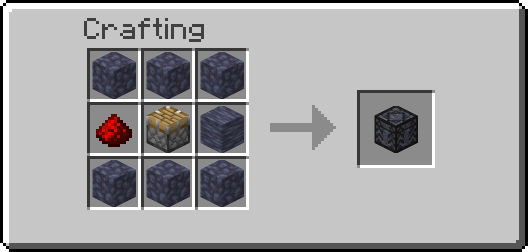<br>Repulser</td><td align="center"><br>Attractor</td></tr>
<tr><td align="center">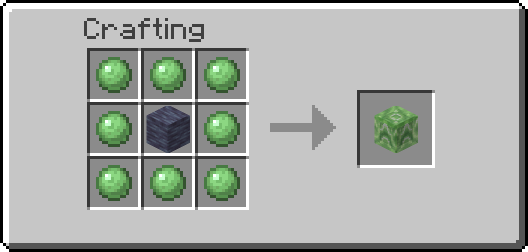<br>Odd Slime</td><td align="center">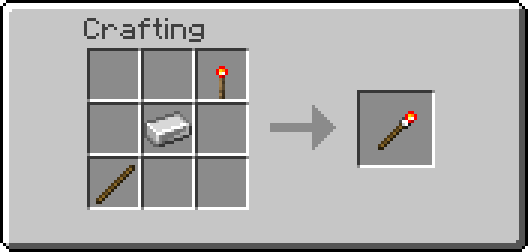<br>Redstone Rod</td></tr>
<tr><td align="center">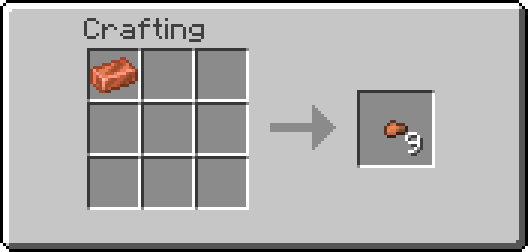<br>Copper Nugget ×9</td><td align="center">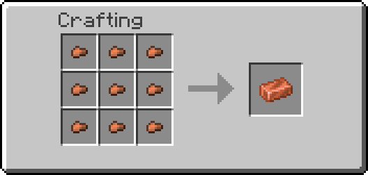<br>Copper ingot from nuggets</td></tr>
</table>

Minecraft 1.20.1 has no copper nugget, so Ideomod adds one (it shows as the iron nugget, tinted copper). Copper nuggets from other mods (the `forge:nuggets/copper` tag) work in these recipes too.

### Oddstone building blocks

<table>
<tr><td align="center">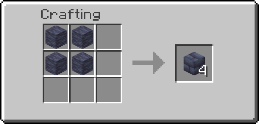<br>Oddstone Bricks ×4</td><td align="center">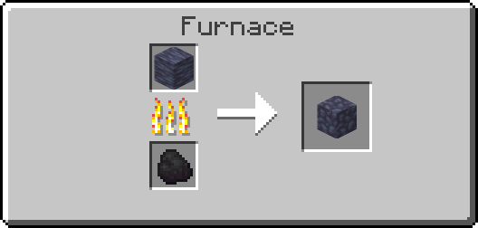<br>Cobbled Oddstone, by smelting</td></tr>
<tr><td align="center"><br>Oddstone Stairs ×4</td><td align="center"><br>Oddstone Slab ×6</td></tr>
<tr><td align="center"><br>Oddstone Wall ×6</td><td align="center"><br>Cobbled Oddstone Stairs ×4</td></tr>
<tr><td align="center">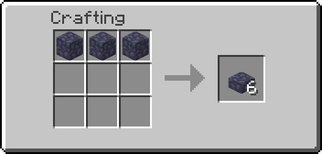<br>Cobbled Oddstone Slab ×6</td><td align="center">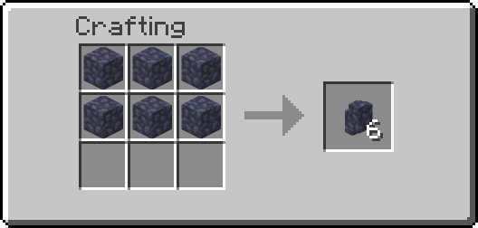<br>Cobbled Oddstone Wall ×6</td></tr>
<tr><td align="center">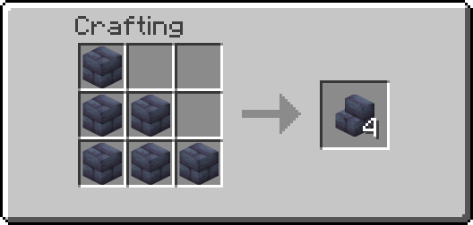<br>Oddstone Brick Stairs ×4</td><td align="center">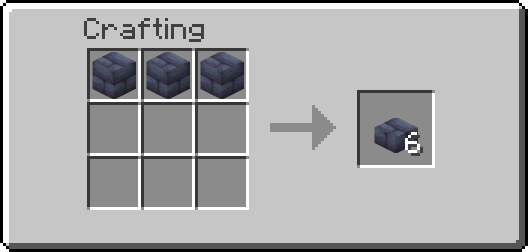<br>Oddstone Brick Slab ×6</td></tr>
<tr><td align="center"><br>Oddstone Brick Wall ×6</td><td align="center">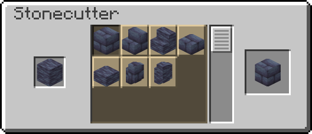<br>Stonecutter: Oddstone</td></tr>
<tr><td align="center"><br>Stonecutter: Cobbled Oddstone</td><td align="center">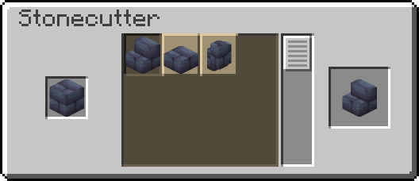<br>Stonecutter: Oddstone Bricks</td></tr>
</table>

Oddstone and Hollowstone come from the world (Hollowstone also from nine shards), so Machine Bases need a trip to the lava-side Hollowstone formations first. The Structure Debug Stick has no recipe and is creative-only.

Mining Oddstone with a normal pickaxe drops Oddstone. Silk Touch gives Cobbled Oddstone, the reverse of vanilla stone.

## Configuration and commands

The config file is `config/machinemod/machinemod.json`, created on first launch.

| Section | Key | Default | What it sets |
|---|---|---|---|
| `oddstone` | `sympathetic_radius` | 12 | Range of sympathetic links and of Transmitters (1 to 16) |
| `oddstone` | `affected_mobs` | every vanilla land mob | Which mobs avoid Oddstone ([mobs from other mods](#mobs-from-other-mods)) |
| `pistons` | `ranged_scan_range` | 12 | Reach of the Repulser and Attractor |
| `pistons` | `base_push_limit` | 12 | Piston push limit before Braces |
| `machine_braces` | `push_limit_per_brace` | 6 | Extra blocks per Brace |
| `machine_braces` | `max_braces` | 8 | How many Braces count |
| `machine_braces` | `max_push_limit` | 60 | Cap on the push limit |
| `pipes` | `item_transfer_cooldown` | 8 | Ticks between items (8 = hopper speed) |
| `pipes` | `fluid_transfer_cooldown` | 8 | Ticks between fluid transfers |
| `portals` | `teleport_cooldown` | 80 | Ticks between portal uses |
| `portals` | `scatter_distance_min` / `_max` | 200 / 1000 | How far an unlinked portal throws you |
| `portals` | `scatter_damage` | 10.0 | Damage from an unlinked portal (10 = 5 hearts) |
| `timer` | `durations` | 5 to 80, step 5 | Timer GUI buttons, in ticks |
| `timer` | `default_index` | 3 | Default Timer button (20 ticks) |
| `engine` | `durations` | 5 to 40, step 5 | Engine GUI buttons, in ticks |
| `engine` | `default_index` | 3 | Default Engine button (20 ticks) |
| `pulser` | `pulse_duration` | 2 | Pulser output length, in ticks |

Commands, both for operators:

- `/machinemod reload` re-reads the config file.

## Living alongside Ideomod

Everything in this mod is in Ideomod too, under the same names in Ideomod's namespace
(`machinemod:oddstone` is `ideomod:oddstone`).

- **Both installed:** this mod steps aside. It adds no blocks, changes nothing about pistons and adds no
  recipes, and Ideomod provides it all.
- **Worlds move both ways.** Opened with this mod, an Ideomod world keeps its Oddstone, machines (with
  their contents and settings), frames and items. Opened with Ideomod, a world built with this mod does
  too. Blocks only Ideomod has are dropped when an Ideomod world is opened here.

## Known rough edges

- **Placeholder art** on the Machine Timer.
- **Hollowstone** loses its inner block when destroyed by anything other than a player (an explosion, say), and cannot be moved by pistons.
- **Framed glass, slime and other see-through blocks** look solid in the inventory. Placed in the world they look right.
- **The Toggle's indicator** is the same colour on all six faces; only the outer texture shows which face is the input.

## For developers

### Building and running

You need JDK 17. From the repository root:

```
./gradlew build        # builds build/libs/ideomancers-machine-mod-0.1.0.jar
./gradlew runClient    # starts a development client with the mod loaded
```

The first run downloads Forge and decompiles Minecraft, which takes a while.

`./gradlew runGameTestServer` runs the in-world tests: a headless server builds small setups (a Pulser ring shaken by a piston, mixed iron and copper frames, a full Fluid Pipe broken and placed again, sympathetic links at the push limit, every recipe's shape, and more), checks the results and exits with a pass or fail.

To check that a built jar really loads, run `scripts/check_jar.sh`. It starts a real Forge server with the jar in its `mods` folder and fails if the mod does not load or the server crashes. GitHub runs the tests and the same jar check on every push (the repository's Actions tab).

### About the pictures

The isometric animations in this README are **illustrations, not screen captures**. They are drawn by a small script ([`tools/renders`](tools/renders)) from the mod's own textures, and each one replays by hand what the code does in that situation. They exist to make the rules easy to see.

The GUI pictures are drawn the same way, from the mod's own GUI textures, by [`tools/renders/gui.py`](tools/renders/gui.py), and the recipe pictures by [`tools/renders/recipes.py`](tools/renders/recipes.py), straight from the recipe files.

### Repository layout

```
src/main/java/com/ideomancer/machinemod/
  block/            Oddstone family, Odd Slime, Hollowstone, Drill
  block/machine/    the Machine Family
  block/frame/      frames, framed blocks, frame activation
  block/movement/   stickiness rules and the shared block mover
  block/piston/     Repulser and Attractor
  block/portal/     Oddstone portals
  mixin/            the piston, redstone wire and entity hooks
  worldgen/         ore-only world type, Hollowstone formations
  gametest/         the in-world tests (runGameTestServer)
  compat/           living alongside Ideomod
  config/ client/ network/ registry/ item/
src/main/resources/ models, textures, lang (assets/machinemod)
  machinemod_data/  the built-in data pack: recipes, loot tables, tags, worldgen
docs/media/         the pictures in this README
tools/renders/      the scripts that draw the illustrations, GUI and recipe pictures
tools/textures/     the script that draws the animated portal texture
scripts/            check_jar.sh (boots the jar on a real server)
```

To redraw the illustrations: `python tools/renders/scenes.py`, `python tools/renders/gui.py` and `python tools/renders/recipes.py` (needs Python 3 and Pillow; vanilla textures are read from a local 1.20.1 client jar).

## License

[Mozilla Public License 2.0](LICENSE). In short: you can use, change and redistribute this mod, and include it in modpacks or build on it in your own projects, open or closed. If you change this mod's own files and share the result, those changed files have to stay under the MPL and their source has to be available.
